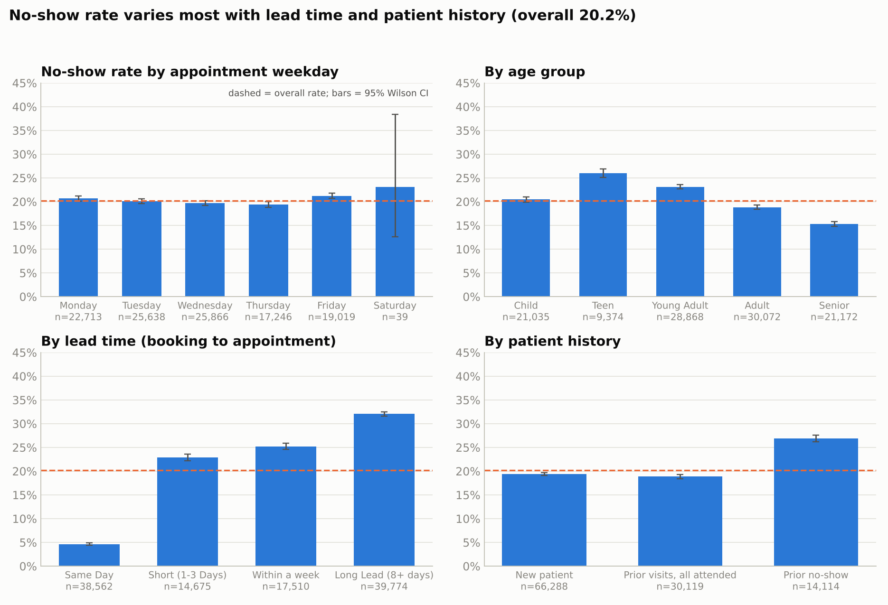
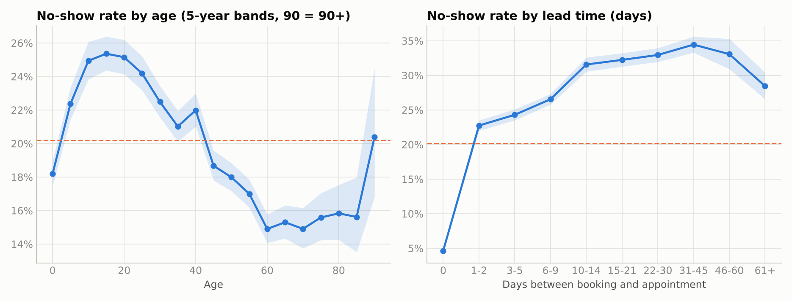
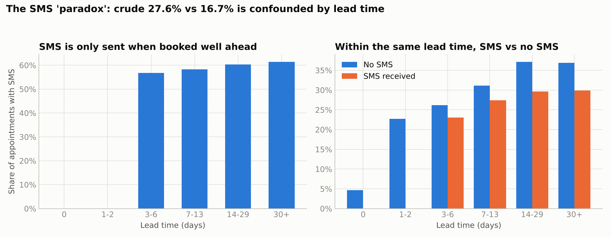
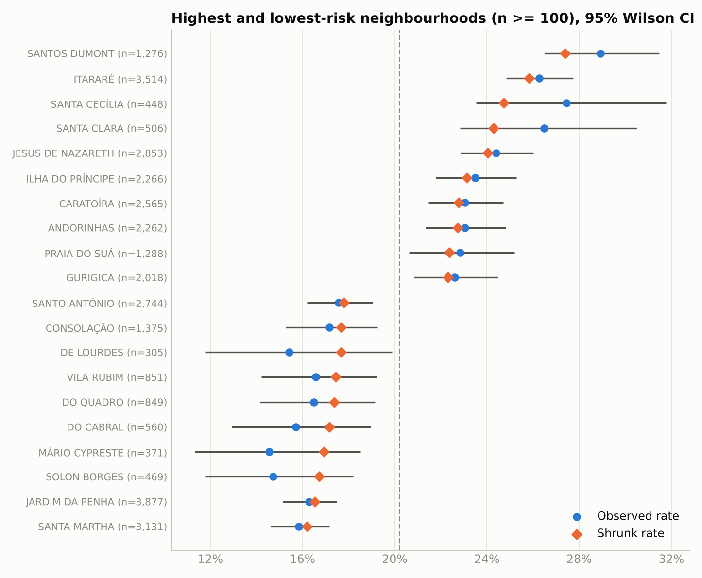
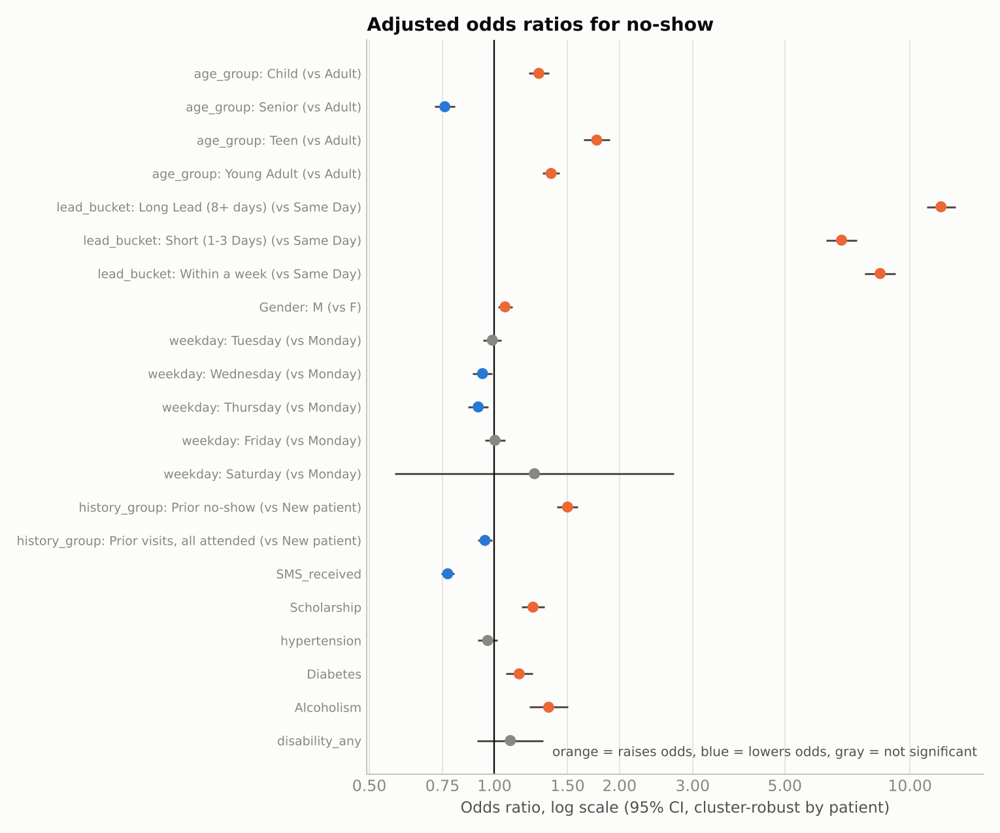
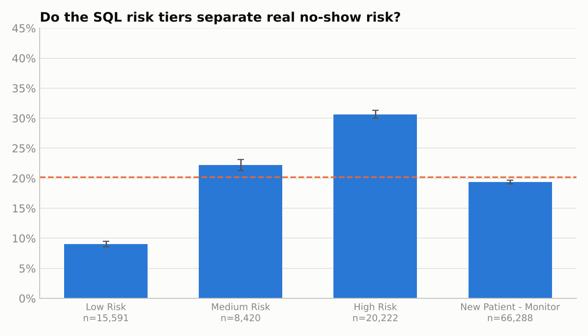
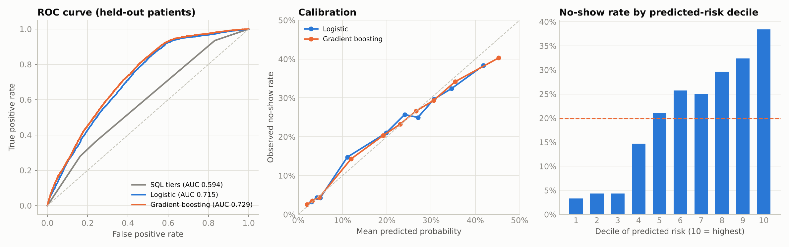

# Medical Appointment No-Show Analysis: Statistical Report

Python statistical companion to the MySQL cleaning and exploration in `SQL_PORTION.sql`.
Dataset: 110,521 appointments, 62,298 patients, appointment dates 2016-04-29 to 2016-06-08.
Everything here is reproducible with one command:

```
pip install pandas numpy scipy statsmodels scikit-learn matplotlib
python analysis.py --data cleaned_data.csv --out outputs
```

## Headline findings

1. **Overall no-show rate is 20.2%** (95% CI 19.95% to 20.43%, 22,314 of 110,521).
2. **Lead time is the dominant driver.** Same-day appointments are missed 4.7% of the time; appointments booked 8+ days ahead are missed 32.1%. Cramér's V = 0.29, more than twice as large as any other factor.
3. **The SMS "paradox" is confounding, not a failure of SMS.** Crude data say patients who got an SMS no-show more (27.6% vs 16.7%, OR 1.90). But SMS was only ever sent when the appointment was booked 3+ days ahead (0% of appointments with lead time 0 to 2 days got one), and long-lead appointments are inherently riskier. Comparing like with like, SMS is associated with **lower** odds of no-show (Mantel-Haenszel OR 0.77, 95% CI 0.75 to 0.80).
4. **Prior no-show history matters.** Patients with a prior no-show miss 26.9% of later appointments vs 19.4% for new patients and 18.8% for patients who attended every prior visit (adjusted OR 1.50 for prior no-show vs new patient).
5. **Several chronic-condition effects flip sign after adjustment**, a textbook confounding example (age drives both). Hypertension looks protective (crude OR 0.79) but is null once age and lead time are controlled (adjusted OR 0.96, CI 0.91 to 1.02). Diabetes goes from 0.86 to 1.15. Alcoholism goes from 1.00 to 1.35.
6. **The SQL risk tiers do separate risk, but leave signal unused.** Low 9.0%, Medium 22.2%, High 30.6%. The "New Patient - Monitor" tier holds 60% of all appointments and averages 19.4%, but inside it the no-show rate ranges from **3.7% (same day) to 30.9% (8+ days)**.
7. **Predictive power is moderate.** On a held-out set of unseen patients, logistic regression reaches AUC 0.715 and gradient boosting 0.729, vs 0.594 for the SQL tier rules.

## Data audit

| Check | Result |
|---|---|
| Rows / patients | 110,521 / 62,298 |
| Missing values | 0 in analysis columns; 5 patient IDs lost precision on CSV export (kept as separate patients via `PatientId_raw`) |
| Duplicate AppointmentIDs | 0 |
| Age range | 0 to 115 (7 patients over 100, retained) |
| Lead time range | 0 to 179 days (no negatives, consistent with the SQL cleaning) |
| Patients with repeat visits | 39% |
| Rows sharing patient and appointment date with another row | 14.7% (matters for history features, see Method notes) |
| Saturday appointments | only 39 rows, so weekday results for Saturday are unreliable |

## 1. Univariate tests

Chi-square tests with Benjamini-Hochberg correction across the 10 factors. With 110k rows almost everything is "significant", so **effect size (Cramér's V) is the number to read**, not the p-value.

| Factor | Cramér's V | Crude OR (95% CI) | Reading |
|---|---|---|---|
| Lead time bucket | 0.295 | n/a | Large |
| SMS received | 0.127 | 1.90 (1.84 to 1.96) | Moderate, but confounded (see section 3) |
| Age group | 0.080 | n/a | Small. Teens highest (26.0%), seniors lowest (15.3%) |
| Hypertension | 0.036 | 0.79 (0.76 to 0.82) | Negligible, explained by age |
| Scholarship | 0.029 | 1.26 (1.20 to 1.32) | Negligible to small |
| Weekday | 0.016 | n/a | Negligible (19.4% to 21.2% Monday to Friday) |
| Diabetes | 0.015 | 0.86 (0.81 to 0.91) | Negligible |
| Any disability | 0.008 | 0.87 (0.78 to 0.97) | Negligible |
| Gender | 0.004 | 0.98 (0.95 to 1.01) | No crude effect (BH-adjusted p = 0.19); tiny after adjustment (section 5) |
| Alcoholism | 0.000 | 1.00 (0.92 to 1.09) | No effect crudely |

Continuous variables (Mann-Whitney U, since both are skewed): no-shows have a median lead time of 11 days vs 2 for attendees (probability that a random no-show has the longer lead time = 0.70). Median age is 33 vs 38 (probability of superiority 0.46, Spearman rho = -0.06).




## 2. The shape of lead time and age

Risk is not linear. No-show rate jumps from 4.7% (same day) to 22.7% (1 to 2 days), climbs to about 34% at 31 to 45 days, then dips for the longest leads (46+ days). That dip is plausibly a different kind of booking (follow-up or chronic-care visits scheduled far ahead), so treat lead time as a bucketed or non-linear feature, not a straight line. Age peaks at about 25% in the teens and early twenties and falls to about 15% from 60 onward.

## 3. SMS confounding (Simpson's-paradox style)

| Lead time | n | SMS share | No-show, no SMS | No-show, SMS |
|---|---|---|---|---|
| 0 days | 38,562 | 0% | 4.7% | n/a |
| 1 to 2 | 11,938 | 0% | 22.7% | n/a |
| 3 to 6 | 15,341 | 57% | 26.2% | 23.1% |
| 7 to 13 | 14,018 | 58% | 31.1% | 27.4% |
| 14 to 29 | 19,580 | 60% | 37.1% | 29.7% |
| 30+ | 11,082 | 61% | 36.9% | 29.9% |

- Within every stratum where both groups exist, SMS recipients no-show **less**, by 3 to 7 percentage points.
- Cochran-Mantel-Haenszel pooled OR = 0.77 (95% CI 0.75 to 0.80). Breslow-Day test p < 0.001, so the effect size varies with lead time (larger at long lead times).
- **Limits of this claim:** there is no SMS data for lead times under 3 days (a positivity violation), so nothing can be said there. The data are observational, so the result is "associated with fewer no-shows", not proof that SMS causes attendance. A randomized pilot would settle it.



## 4. Neighbourhood risk

- 74 neighbourhoods with at least 100 appointments. Overall chi-square p < 1e-60, Cramér's V = 0.067 (small).
- 23 of 74 differ significantly from the overall rate after Benjamini-Hochberg correction.
- Highest: Santos Dumont (28.9%, n = 1,276), Itararé (26.3%, n = 3,514). Lowest: Santa Martha (15.8%, n = 3,131), Jardim da Penha (16.3%, n = 3,877).
- Small neighbourhoods are shrunk toward the mean using a beta-binomial (empirical Bayes) prior, so a neighbourhood with 300 rows and a lucky streak does not top the ranking. Compare the blue (raw) and orange (shrunk) markers in the figure.
- After adjusting for age, lead time, history and the rest, neighbourhood still adds information (likelihood-ratio test p < 1e-30), but McFadden pseudo R-squared only moves from 0.117 to 0.120. It is detectable, not large.



## 5. Adjusted logistic regression

Outcome: no-show. Predictors: age group, lead-time bucket, SMS, scholarship, hypertension, diabetes, alcoholism, any disability, gender, weekday, patient history. Standard errors are **clustered by patient** because 39% of patients appear more than once. McFadden pseudo R-squared = 0.117.

| Factor | Adjusted OR (95% CI) |
|---|---|
| Lead 8+ days vs same day | 11.9 (11.0 to 12.9) |
| Lead 4 to 7 days vs same day | 8.5 (7.8 to 9.2) |
| Lead 1 to 3 days vs same day | 6.8 (6.3 to 7.5) |
| Teen vs adult (40 to 59) | 1.76 (1.64 to 1.90) |
| Young adult vs adult | 1.37 (1.31 to 1.44) |
| Senior vs adult | 0.76 (0.72 to 0.80) |
| Prior no-show vs new patient | 1.50 (1.41 to 1.59) |
| SMS received | 0.77 (0.74 to 0.80) |
| Alcoholism | 1.35 (1.21 to 1.50) |
| Scholarship | 1.24 (1.16 to 1.32) |
| Diabetes | 1.15 (1.06 to 1.24) |
| Male vs female | 1.06 (1.02 to 1.10) |
| Hypertension | 0.96 (0.91 to 1.02), not significant |
| Any disability | 1.09 (0.91 to 1.31), not significant |

Odds ratios are not risk ratios: an OR of 11.9 does not mean 11.9 times the probability. It compares odds (4.7% vs 32.1% raw rates). The full table is in `outputs/tables/logit_adjusted_odds_ratios.csv` and the crude-vs-adjusted comparison in `crude_vs_adjusted_or.csv`.



## 6. SQL risk tiers, validated

| Tier | n | Share | No-show rate (95% CI) |
|---|---|---|---|
| Low Risk | 15,591 | 14% | 9.0% (8.6 to 9.5) |
| Medium Risk | 8,420 | 8% | 22.2% (21.3 to 23.1) |
| High Risk | 20,222 | 18% | 30.6% (30.0 to 31.3) |
| New Patient - Monitor | 66,288 | 60% | 19.4% (19.1 to 19.7) |

The tiers are ordered correctly and well separated (chi-square p < 1e-300, V = 0.154). The weakness is structural: because "New Patient" is checked first, those rows never get a lead-time rule, even though lead time is the strongest predictor. Within that tier: same day 3.7%, 1 to 3 days 23.7%, 4 to 7 days 25.1%, 8+ days 30.9%. **Suggested SQL change:** apply the lead-time conditions to new patients too, so the 60% bucket splits into Low, Medium and High.



## 7. Predictive evaluation

Train/test split of 80/20 **by patient** (22,530 test rows, 19.9% prevalence), so no patient appears in both sets.

| Model | ROC AUC (95% CI) | PR AUC | Precision in top 10% | Lift in top 10% | Share of no-shows caught in top 20% |
|---|---|---|---|---|---|
| SQL tiers (rule-based) | 0.594 (0.587 to 0.602) | 0.244 | 29.8% | 1.5x | 29.4% |
| Logistic regression | 0.715 (0.708 to 0.722) | 0.341 | 38.3% | 1.9x | 35.6% |
| Gradient boosting | 0.729 (0.721 to 0.736) | 0.360 | 40.3% | 2.0x | 37.5% |

- Calibration is good for both models (predicted risk tracks observed rate in each decile). The lowest three deciles have a 3 to 4% no-show rate and the top decile 38%, a 12-fold spread that is useful for deciding who gets reminder calls or who could be double-booked.
- Permutation importance for gradient boosting: lead time (AUC drop 0.20) dwarfs age (0.03), neighbourhood (0.01) and prior no-show rate (0.005).
- A 0.73 AUC is realistic for no-show prediction with administrative data only. Accuracy would be a misleading metric here (predicting "everyone attends" scores about 80%).
- **Sensitivity check:** history features computed as of the appointment date could include outcomes not yet known when the visit was booked (this applies to 12.9% of rows). Restricting history to what was known at booking time gives AUC 0.714 vs 0.715, so the result is robust.



## Method notes and limitations

- **Multiple testing:** Benjamini-Hochberg false-discovery-rate control for the 10 univariate tests and the 74 neighbourhood tests.
- **Repeated patients:** cluster-robust standard errors in the regression, and a patient-grouped train/test split so rows from one patient never leak across sets. AUC bootstrap intervals resample rows and are slightly optimistic.
- **History features:** counted from appointments on strictly earlier dates. The SQL window function counts same-day rows by arbitrary tie order (14.7% of rows share a patient and date), so its prior counts can differ slightly from the Python version.
- **Observational data:** all associations. Neighbourhood, scholarship and SMS may stand in for unmeasured factors (income, distance, transport).
- **Short window:** about six weeks of appointments, so seasonality cannot be assessed.

## Files

| File | Purpose |
|---|---|
| `analysis.py` | Full reproducible analysis |
| `outputs/figures/` | 7 charts (PNG) |
| `outputs/tables/` | 13 result tables (CSV) |
| `outputs/summary.json` | Headline numbers in machine-readable form |
| `outputs/run_log.txt` | Console output of the last run |
